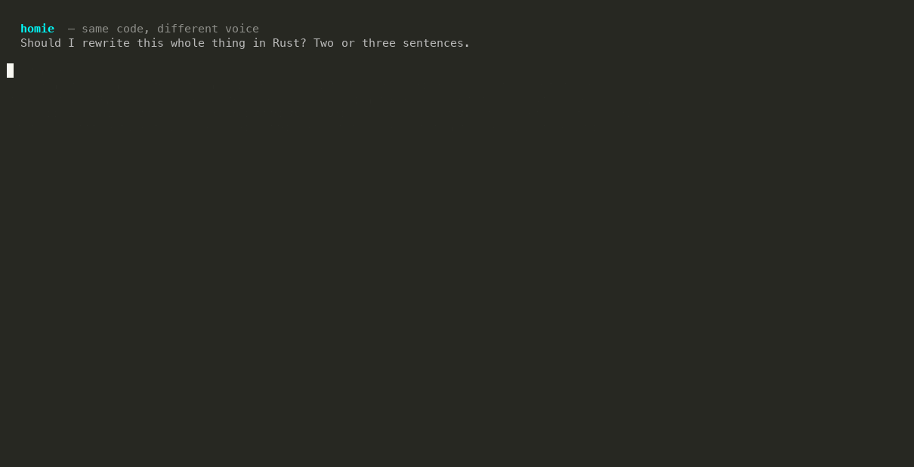

<p align="center">
  
</p>

<h1 align="center">homie</h1>

<p align="center"><em>Same brain. Same code. Different voice.</em></p>

<p align="center">
  
</p>

Your coding agent didn't need another corporate assistant. **homie** switches
its chat voice to a technically competent friend — in three levels:

| Level | Voice |
|-------|-------|
| 😌 **yo** | Friend talk. Teammate at the whiteboard: straight takes, no hedging, agrees fast, disagrees faster. Never opens or closes like an assistant. No profanity. |
| 😏 **dawg** | Brutal opinions with playful energy. Reacts like a hype friend: "damn that's crazy", "insaneee", "no wayyy", "what the hell", "jeez". Roasts the work, not you. Mild swearing (damn, hell, crap), rarely. |
| 💀 **mafa** | No mercy zone. Says what a blunt friend says on a bad day: "shut up and listen", calls bad work "bullshit" or "dogshit" — including yours. Swears zero to four times per response, never forced. Roasts the person too. **Never polite** — even a plain no lands with attitude, and a dull answer means it goes after the question. Zero swears is fine; sounding like a support agent is not. |

> [!NOTE]
> **Default is dawg.** Out of the box homie is blunt with mild swearing. Want
> the clean voice? `/homie default yo`, or set `HOMIE_DEFAULT_LEVEL=yo`.

> [!CAUTION]
> **mafa has no mercy.** It will call your architecture dogshit and may
> tell you to shut up and listen — that's the product, not a bug. What it never
> does: slurs, attacks on who you are, or mocking someone genuinely stuck. It
> still drops the bit when things get real. Opting into mafa is opting into a
> harsh friend.

**Voice only.** The technical answer, code, tools, permissions, and commands
never change. Every level raises the same concerns — yo just says them more
gently. Never lets niceness bury a real issue.

**Voice lives in prose only.** Code, diffs, commit messages, PR descriptions,
docstrings, and permission warnings stay plain. A joke in a commit message
sits in git history for every teammate to read.

**It knows when to drop the bit.** Prod down? User stuck? Destructive action?
Credentials involved? It switches to plain, calm, direct — and resumes the
voice after.

## Before / after

Same prompt, four levels. Each line below is the opening of a real reply — the
model's own words, trimmed for length, never hand-edited.

> **"Should I use microservices for my todo app?"**

**Normal:**

> For almost any todo app: no, start with a monolith. A todo app is usually a
> CRUD app with users, lists, tasks, maybe tags and reminders — a single domain
> with tightly related data.

**yo:**

> nah, skip it. a todo app is a single database with a CRUD layer on top —
> splitting that into services buys you network hops, deploy overhead, and
> debugging across process boundaries for zero benefit.

**dawg:**

> Straight opinion: no. A todo app is the textbook case for a monolith. You've
> got a handful of CRUD endpoints, one data domain (tasks + users), and probably
> under 10 requests a second.

**mafa:**

> No. A todo app is a CRUD app with one database and zero scaling pressure.
> Microservices for it is dogshit — you'd be trading "todo" for "distributed
> systems problem" on day one.

Same verdict, four registers. Only the voice changes.

## Install

Choose your agent:

<details open>
<summary><strong>Claude Code</strong></summary>

```
/plugin marketplace add prashanthgit19/homie
```

```
/plugin install homie@homie
```

(two separate prompts)

</details>

<details open>
<summary><strong>OpenCode</strong></summary>

```bash
opencode plugin add @kpnpm/homie
```

or in a project's `opencode.json`:

```json
{ "plugins": ["@kpnpm/homie"] }
```

</details>

<details open>
<summary><strong>Codex</strong></summary>

```bash
codex plugin marketplace add prashanthgit19/homie
codex plugin add homie@homie
```

Then open `/hooks` in Codex, trust the two lifecycle hooks, and start a new
thread.

</details>

<details open>
<summary><strong>Pi (pi.dev)</strong></summary>

```bash
pi install npm:@kpnpm/homie
```

Also works for Oh My Pi (`omp`), which runs Pi extensions unchanged.

</details>

<details open>
<summary><strong>Any other agent</strong></summary>

One command copies the skill into most agents' skills folders (Claude Code,
Codex, OpenCode, Cursor, Windsurf, Cline, Gemini, and more):

```bash
npx skills add prashanthgit19/homie
```

Or copy [`AGENTS.md`](AGENTS.md) into your project, or ask your agent to install
[`skills/homie/SKILL.md`](skills/homie/SKILL.md) as a skill. More in
[INSTALL.md](INSTALL.md).

</details>

## Commands

| Command | What it does |
| --- | --- |
| `/homie` | Turn the voice on at your configured default (**dawg**); already on → report the current level |
| `/homie yo` \| `dawg` \| `mafa` | Set the level |
| `/homie off` | Back to normal |
| `/homie default <level>` | Set what new sessions start at (persists across restarts) |

Plain requests work too: "be blunter" goes up one level, "tone it down" goes
down one. "stop homie" turns it off.

Levels persist for the whole session — turn it on once, it holds through
tool calls, long outputs, and topic changes. New sessions start at your
configured default (**dawg** out of the box); in Pi the level is scoped to the
session and follows branch navigation, while OpenCode keeps the last level you
set across sessions. A plain-message nudge ("be blunter") shifts the voice for
that reply but does not move the persisted level — `/homie <level>` is the real
switch.

## Settings

Default level for new sessions, in priority order:

1. `HOMIE_DEFAULT_LEVEL` env var (`off`/`yo`/`dawg`/`mafa`)
2. `~/.config/homie/config.json` → `{ "defaultLevel": "dawg" }`
3. `dawg` (built-in default)

Want the clean voice everywhere? `HOMIE_DEFAULT_LEVEL=yo`, or
`/homie default yo`.

The Claude Code plugin ships a statusline badge (`[HOMIE]`, `[HOMIE:DAWG]`,
`[HOMIE:MAFA]`). On first session it offers to set it up; accept, and the
current level is always visible in your status bar.

## How it works

One prompt — [`skills/homie/SKILL.md`](skills/homie/SKILL.md) — is the whole
product. No fine-tuning, no second LLM, no proxy. Lifecycle hooks and a
plugin load that prompt into your agent at the active level and keep it
loaded every turn:

```
/homie mafa → flag file → every turn re-injects the mafa policy
```

- **Claude Code / Codex:** `SessionStart` injects the ruleset; `UserPromptSubmit` tracks `/homie` switches mid-session.
- **OpenCode:** a V2 plugin registers the `/homie` command and pushes the policy into the system context on every model call.
- **Pi (pi.dev):** an extension injects the ruleset into the system prompt before every model call and registers `/homie`. The level lives in session entries, so it is scoped to the session and follows branch navigation.
- **Others:** the `AGENTS.md` rules file.

Subagents don't get the voice — subagent prose isn't user-facing.

## FAQ

**Does it change what the agent recommends?** No. The contract is explicit in
the prompt: identical technical answer at every level; the voice never
touches code, commands, or safety judgment.

**Will it swear at me constantly?** No. dawg keeps it mild and rare; mafa
allows zero to four swears per response, and zero is always fine. Forced
profanity is called out in the prompt as the main failure mode.

**Does mafa hold back?** For the *work*, no — it's a no-mercy zone, including
roasting you. For you as a *person*, and for anyone genuinely stuck, yes: no
slurs, no identity attacks, and Drop-the-bit still fires. It's a harsh friend,
not a bully.

## License

[MIT](LICENSE)
